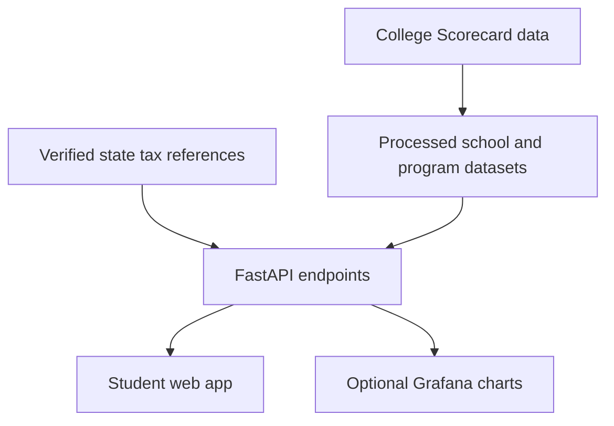

# GradPath

**A clearer path from choosing a U.S. college to paying for it.**

Choosing a degree can feel like choosing a future while the tuition bill is already due. Students and
families have to weigh school costs, savings, loans, part-time work and possible earnings, often in
different places and with different assumptions. GradPath brings those questions together. It helps
a student ask: *What could this degree cost, how much might I borrow, and what might repayment look
like after graduation?*

GradPath is a U.S.-only student planning app built with FastAPI and U.S. Department of Education
College Scorecard data. It compares historical program earnings and student debt, shows verified
state income-tax information where available, and turns a student's own inputs into a funding and
loan repayment plan. It offers a range of outcomes rather than a promise about anyone's future.

> Historical earnings are not salary guarantees. GradPath provides educational estimates, not
> personalized financial or tax advice.

## How to use GradPath

1. **Explore schools and programs.** Search by school, location or major. Compare published median
   earnings, federal student-loan debt and debt-to-earnings outcomes. The financial outcome groups
   describe reported debt burden; they do not rank prestige or admission chances.
2. **Build a plan.** Choose a school and expected graduation year. Enter tuition, living expenses,
   grants and recurring savings per month or per year. Add current savings and either a known loan
   amount or let GradPath estimate borrowing from the remaining cost.
3. **Consider work and career income.** Enter an expected starting salary or use a historical program
   median where available. Estimate part-time pay by hour, week or month. Where state tax information
   is verified, the plan uses estimated pay after state income tax for the work contribution; federal
   and payroll taxes are not included.
4. **Review the result.** Check the assumptions and see the funding gap, debt when repayment begins,
   monthly payment, and a month-by-month debt-free timeline under three salary scenarios. Edit any
   input to see how the plan changes.

If tuition is unknown, the funding step shows published College Scorecard tuition and cost of
attendance, a 12-month equivalent, its source release and a link to the school's official website.
The monthly figure is arithmetic, not the school's billing schedule. GradPath does not scrape live
fees; students can confirm current costs on the official site and enter an updated estimate.

## System design and architecture



The student app in `gradpath/static/app/` provides the navigation, search, four-step planner and
accessible results. `gradpath/src/api.py` serves the app and API; `app_routes.py` handles student
endpoints. Processed datasets in `gradpath/data/processed/` are committed so the app and the Render
deployment do not need the large raw downloads at startup. Optional Grafana dashboards reuse the
same API for detailed charts. The app and its tables work without Grafana.

### Data, calculations and privacy

- **Program outcomes:** College Scorecard historical median earnings and median federal student-loan
  debt. The latter is debt borrowed at the school, not the full cost of attendance. Some small
  cohorts are suppressed. School or major does not cause a particular future income.
- **School costs:** the directory stores published tuition, cost of attendance, source release and
  institution website. The tuition source agent returns these figures and 12-month equivalents.
  Monthly costs entered by a student are multiplied by 12 for each school year. Current savings is
  treated as a one-time balance.
- **State taxes:** tax-year-2025 references cover CA, NY, TX, FL, WA, PA, IL, NC, MA and GA. Detailed
  single-filer brackets are available for CA and NY. Unverified states are marked as such rather than
  assigned a guessed rate. State rules can change.
- **Repayment:** `gradpath/src/plan_calc.py` calculates loan principal, interest accrued during school,
  a standard 10-year payment and salary-based repayment scenarios. The deterministic repayment
  timeline agent builds monthly balances, milestones and a step-by-step explanation. See
  [the methodology](gradpath/docs/methodology.md) for data definitions and assumptions.
- **Privacy:** draft answers stay in the student's browser storage. Calculations send answers to
  `POST /plan/calculate` in the request body; the server does not store them, and financial inputs
  are not placed in the URL. The older Grafana My Plan is retained in the legacy folder with a
  warning because its behavior differs.
- **Accessibility:** labeled inputs, visible focus, keyboard navigation, responsive layouts,
  descriptive chart alternatives and tables support the full journey.

The processed data reflects a particular release and can lag current fees, tax rules and job-market
conditions. Check current school fees and loan terms before making a financial commitment.

## Install and run

Run commands from the repository root. Python 3.11+ is required. The processed data is already
included in the repository.

### Student app

```bash
python3 -m venv .venv
source .venv/bin/activate
python3 -m pip install -r gradpath/requirements.txt
python3 -m uvicorn api:app --app-dir gradpath/src --host 127.0.0.1 --port 8000
```

Leave that terminal running and open the **Local student app** link below. No login or Grafana setup
is needed for the app and its result tables. Press `Ctrl+C` to stop the server.

### Optional Grafana charts on macOS

Install [Homebrew](https://brew.sh), Grafana and the JSON API datasource plugin:

```bash
brew install grafana
grafana cli \
  --homepath /opt/homebrew/opt/grafana/share/grafana \
  --pluginsDir /opt/homebrew/var/lib/grafana/plugins \
  plugins install marcusolsson-json-datasource
```

Set `[paths] provisioning` in `/opt/homebrew/etc/grafana/grafana.ini` to the repository's
`gradpath/grafana/provisioning` directory. An example is at `gradpath/grafana/grafana.ini`.
With the Python dependencies installed, `./start.sh` starts the app and Grafana together. Stop any
separately running API server first so port 8000 is free. Grafana uses port 3000.

### Validate or refresh

```bash
python3 -m unittest discover -s gradpath/tests -v
python3 gradpath/tests/stress_plan.py --quick  # with the app running
```

To rebuild datasets after downloading a newer College Scorecard release, put the raw files under
`dataset/`, update `gradpath/src/config.py`, then run:

```bash
cd gradpath
python3 src/prepare_data.py
python3 src/build_reference_data.py
python3 grafana/build_dashboards.py
```

Restart the app after rebuilding data because it caches read-only datasets in memory. The raw
College Scorecard downloads are not committed; this rebuild is unnecessary for a normal install.

### Deploy to Render

The repository's `render.yaml` defines one Python web service rooted at `gradpath/`. Push the branch,
create a **New → Blueprint** in Render, connect the repository and review the configuration. Render
starts FastAPI on its assigned `$PORT` and checks `/meta/health`. The hosted student app works without
Grafana or secret environment variables. Add the generated address to **Hosted demo** below after
verifying the school-to-plan journey. A separately hosted Grafana can be connected with
`GRADPATH_GRAFANA_URL`.

## Links

- **Local student app:** [http://localhost:8000](http://localhost:8000) (available while the server runs)
- **Repository:** [Sujay1709/gradpath](https://github.com/Sujay1709/gradpath)
- **Hosted demo:** Add the Render URL after deployment.
- **API docs and health:** `/docs` and `/meta/health` on the student app.

| App page | Path | Purpose |
| --- | --- | --- |
| Overview | `/` | Start here and explore outcomes |
| My Plan | `/plan` | Build, review and calculate a personal plan |
| Schools | `/schools` | Search schools and programs |
| Graphs | `/graphs` | Compare outcomes in charts and tables |
| States | `/states` | Review verified state tax information |
| Help | `/help` | Understand metrics, sources, privacy and limitations |

Optional Grafana admin and analyst views run on port 3000 when installed.
